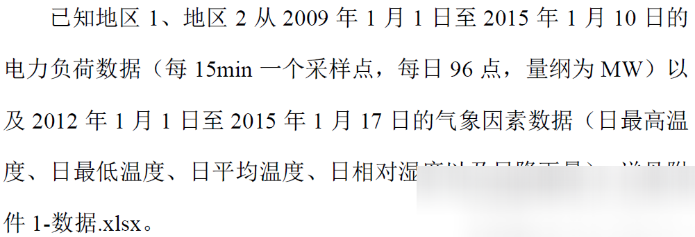
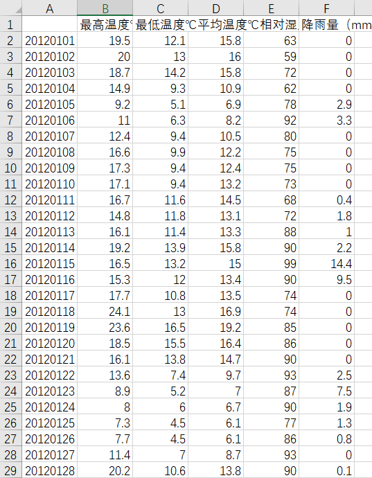
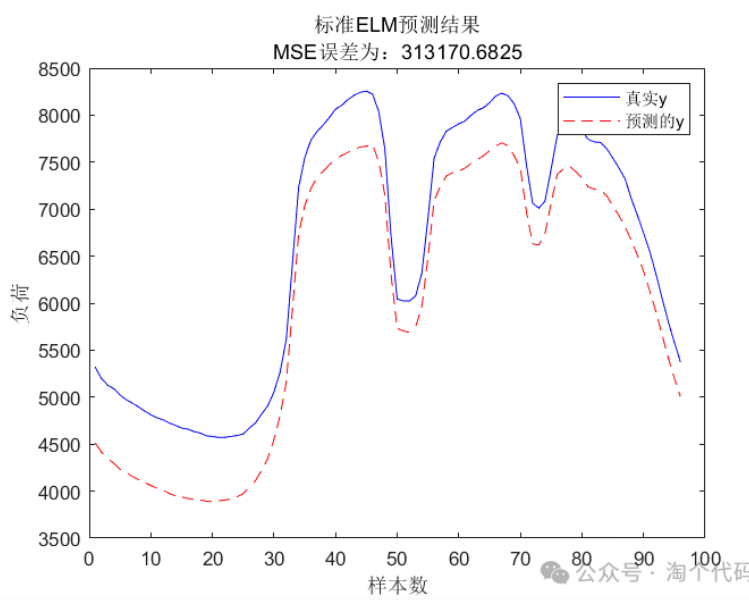
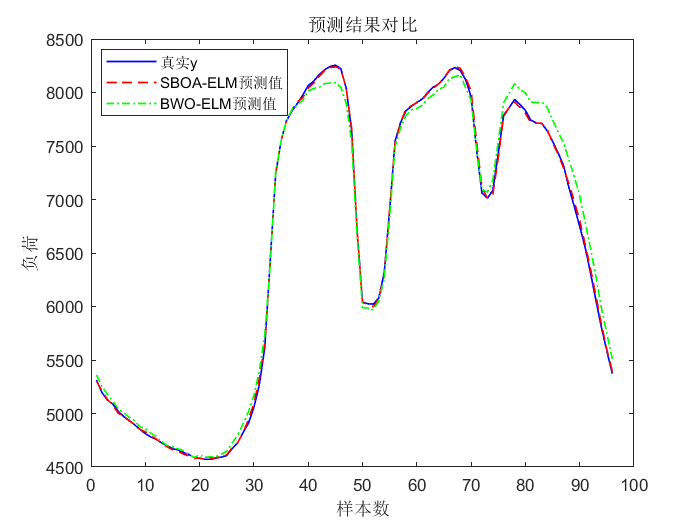
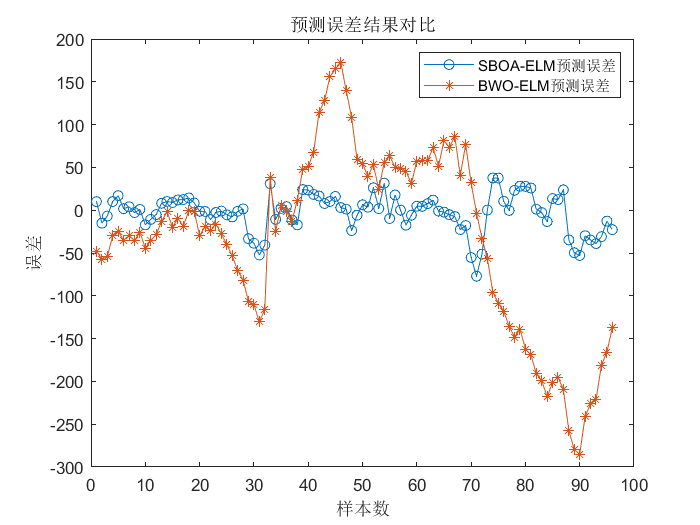
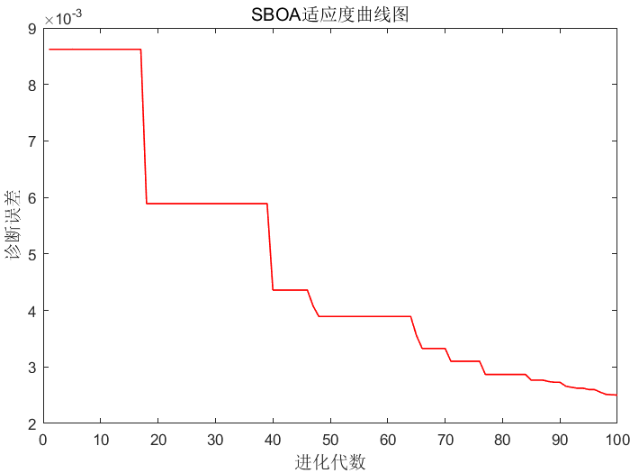
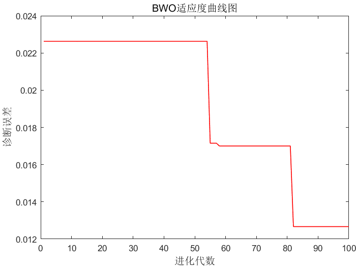

# Prediction of power load 96 steps ahead, using the latest LEENG algorithm optimized ELM in 2024, MATLAB code

The current electricity load forecasting data source is from the "Ninth Electrical Mathematics Modeling Competition Questionnaire - 2016".
Data overview:
- Brief introduction:
  - This session includes:
    ① A simple comprehensive processing of the electricity load data to divide training set and test set.
    ② The implementation of power load forecasting using a standard ELM (Extended Learning Machine).
    ③ Optimization of the weights and thresholds of the ELM using the Liaoyong algorithm in 2024, reducing prediction errors.
    ④ Optimization of the ELM using the White Whale algorithm and comparing it with the Liaoyong algorithm to highlight the efficiency and accuracy of the Liaoyong algorithm.
Detailed explanation:
- Processing of the electricity load data:
  - The data contains temperature ranges (℃), minimum temperature (℃), average temperature (℃), relative humidity (average), rainfall (mm) for the period from January 1, 2012 to January 17, 2015. Some screenshots are as follows:
    \n        \n  
    The processing method is as follows:
    - Integrate the load data and weather data from January 1, 2012 to January 17, 2015, which have both weather characteristics and load data, into the variable 'data'.
    - Select the first 6 days of data (including load and the highest temperature (℃), lowest temperature (℃), average temperature (℃), relative humidity (average), rainfall (mm)) to predict future day data.
    - In the code, a total of 60 samples were selected as the training set, and one sample was used as the test set, achieving load prediction for the next 96 time steps.
    - MAPE was used as the error indicator (many literatures follow this approach!).
- Training and prediction of the ELM (Extended Learning Machine) on the electricity load data:
  Prediction results:
  - It can be seen that the unoptimized ELM prediction effect is not very ideal.
- Optimization of the weights and thresholds of the ELM using the Liaoyong algorithm in 2024, and comparison with the White Whale algorithm.
  - \n        \n  
  - \n        \n  
  - \n        \n  
  - \n        \n
By comparing the error curve and prediction results, it can be seen that the convergence accuracy of the eagle algorithm (SBOA) optimized ELM is very high!
Principle code:
The data replacement is relatively simple, the code is simple to understand, which can be redeveloped.
Code acquisition:
The directory of the code is as follows:

## Images

<!-- PAYMENT_BLOCK -->

## Get this dataset

- Payment link (Stripe): [Buy now](https://buy.stripe.com/3cs8yP7sY87d0vu9AB)
- Payment QR code: 

<!-- /PAYMENT_BLOCK -->
